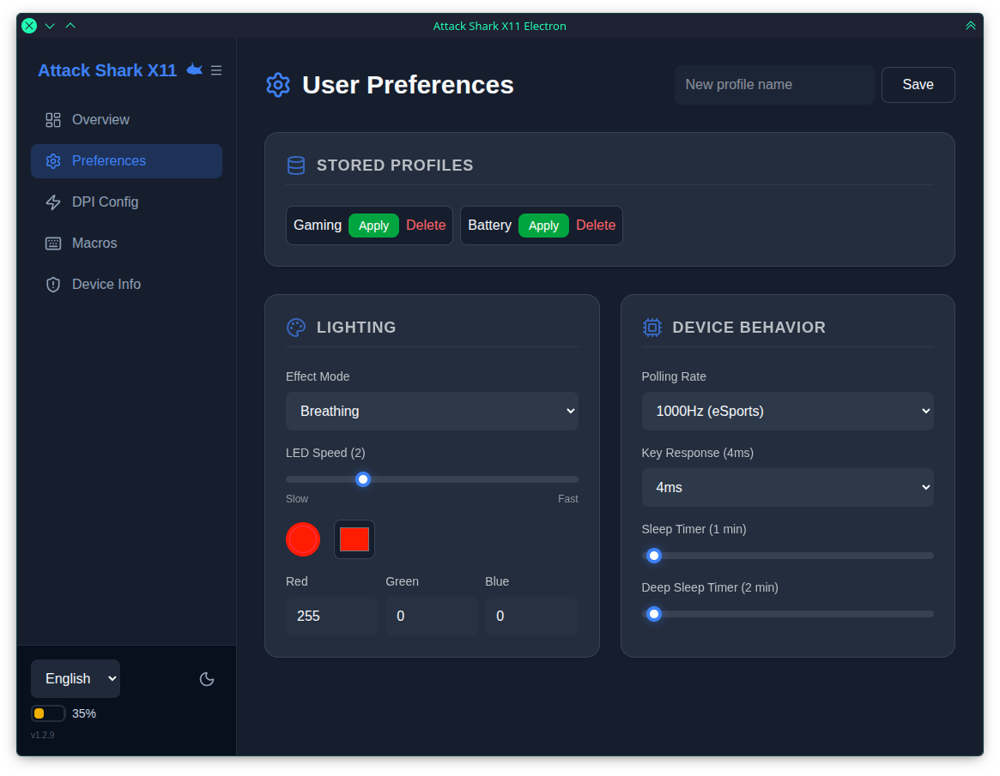

<p align="center">
  
</p>

<h1 align="center">Attack Shark X11 Driver</h1>

<p align="center">
  Настройка мыши <b>Attack Shark X11</b> и <b>R1</b> с компьютера:<br>
  DPI, макросы, подсветка, частота опроса, батарея и сброс.
</p>

<p align="center">
  <a href="https://github.com/furkuki-dev/attack-shark-x11-win32/releases"></a>
  <a href="https://github.com/furkuki-dev/attack-shark-x11-win32/releases"></a>
  <a href="https://github.com/furkuki-dev/attack-shark-x11-win32/actions/workflows/project.yml"></a>
  
  
  
</p>

> ⚠️ **Проект экспериментальный.** Перед использованием на основном компьютере проверь, что сборка запускается и мышь определяется.

---

## ✨ Возможности

<table>
  <tr>
    <td width="50%">
      <h3>🎯 DPI</h3>
      Настройка ступеней чувствительности.
    </td>
    <td width="50%">
      <h3>🖱️ Макросы</h3>
      Редактор с задержками между действиями.
    </td>
  </tr>
  <tr>
    <td>
      <h3>💡 Подсветка</h3>
      Режим, скорость и цвет.
    </td>
    <td>
      <h3>⚡ Частота опроса</h3>
      От 125 до 1000 Гц.
    </td>
  </tr>
  <tr>
    <td>
      <h3>🔋 Батарея</h3>
      Отображение уровня заряда.
    </td>
    <td>
      <h3>♻️ Сброс</h3>
      Возврат настроек устройства к заводским.
    </td>
  </tr>
  <tr>
    <td>
      <h3>🔌 Автоопределение</h3>
      Мышь находится сама при запуске.
    </td>
    <td>
      <h3>💾 Сохранение</h3>
      Настройки сохраняются между запусками.
    </td>
  </tr>
  <tr>
    <td>
      <h3>🌗 Темы</h3>
      Тёмная, светлая и Cappuccino.
    </td>
    <td>
      <h3>🌍 Языки</h3>
      English и Español.
    </td>
  </tr>
</table>

**Поддерживаемые модели:** Attack Shark **X11** и **R1**. Модель определяется автоматически.

---

## 📥 Скачать

Готовые сборки на странице [**Releases**](https://github.com/furkuki-dev/attack-shark-x11-win32/releases).

| Файл | Что это | Для кого |
|---|---|---|
| `*-setup.exe` | Установщик с ярлыками и автообновлением | Обычная установка |
| `*-portable.exe` | Запуск без установки | Флешка, быстрый тест |

В каждом релизе есть контрольные суммы **SHA-256**. Проверь файл перед запуском:

```powershell
Get-FileHash .\attack-shark-x11-electron-1.4.6-ia32-setup.exe -Algorithm SHA256
